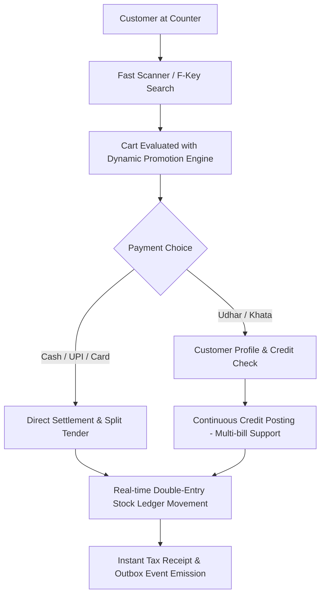

# Business Requirements Document (BRD)

| Document ID | AMB-BRD-002 | Version | 1.0.0 |
| :--- | :--- | :--- | :--- |
| **Project** | AMBURAX G-POS | Status | Approved |
| **Owner** | Product Architecture Team | Date | 2026-10-19 |

---

## 1. Business Context & Problem Statement

Traditional retail counter systems face four fundamental bottlenecks:

1. **Checkout Friction**: Clerks frequently reach for mice to click through dialog boxes. Cashiers take 45–90 seconds per customer during holiday rushes, leading to abandoned queues.
2. **Promotional Conflicts**: When multiple promotional campaigns are active, systems either stack discounts uncontrolledly (eroding profit margins) or crash. Cashiers cannot easily disable or toggle an offer when an Udhar customer is not entitled to one.
3. **Credit Risk & Customer Disputes**: Store owners extend credit (Udhar) on paper diaries or loose note pads. Customers frequently dispute billing lines or claim partial repayments were missed.
4. **Inventory Variance**: POS software updates an aggregate numeric column (`stock_qty = stock_qty - 1`) without transactional logs. When inventory vanishes, managers cannot differentiate between theft, damaged goods, or billing errors.

---

## 2. Proposed Business Solutions

### 2.1 Fast-Flow Checkout
- Cashiers operate with dedicated function keys (`F1`–`F10`).
- Scan items with standard 1D/2D USB or Bluetooth barcode scanners without moving cursor focus.
- Automatically handle apparel sizing, colors, and tax rate variations.

### 2.2 Controlled Promotional Governance
- Store owners define promotion rules: Percentage Off, Flat Rupee Off, Buy X Get Y Free, Tiered Spend discounts.
- Enforce **Single Best Offer** by default to protect retailer gross margin.
- Enable Cashiers/Managers to review, select, start/stop, or completely clear an applied offer directly within the counter modal without switching application tabs.

### 2.3 Transparent Khata (Credit) Accounting
- Customer mobile phone verification via OTP ensures identity before credit extension.
- Multi-bill continuity: store owners can issue subsequent Udhar sales without forcing customers to clear past bills first, subject to merchant discretion or credit limit.
- Accurate ledger tracking: every credit sale, repayment, and advance is stamped with an immutable transaction ID.

### 2.4 Traceable Stock Management
- Inventory is tracked through an operational stock movement ledger (`SALE`, `PURCHASE_RECEIPT`, `TRANSFER_IN`, `TRANSFER_OUT`, `ADJUSTMENT`).
- Never allow unmonitored aggregate updates.

---

## 3. Business Approval Matrix & Delegation of Authority

| Action | Allowed Role(s) | Authentication Required |
| :--- | :--- | :--- |
| Ring Sale (Cash, UPI, Card) | Cashier, Store Manager, Owner | User Session |
| Ring Sale on Udhar (Within Limit) | Cashier, Store Manager, Owner | User Session + Verified Customer Phone |
| Cashier Discount (<= 10%) | Cashier, Store Manager, Owner | Self Reason Provided (3+ chars) |
| Large Discount (> 10%) | Store Manager, Owner | Manager / Owner PIN Verification |
| Add / Start / Stop Offers | Cashier (View/Toggle), Manager, Owner (Full) | Role Permission |
| Float Open / Close & Day End | Cashier (Count Submission), Manager (Sign-off) | Dual Cash Declaration |
| Stock Adjustment / Write-off | Store Manager, Inventory Manager | Reason Code + Management Approval |
