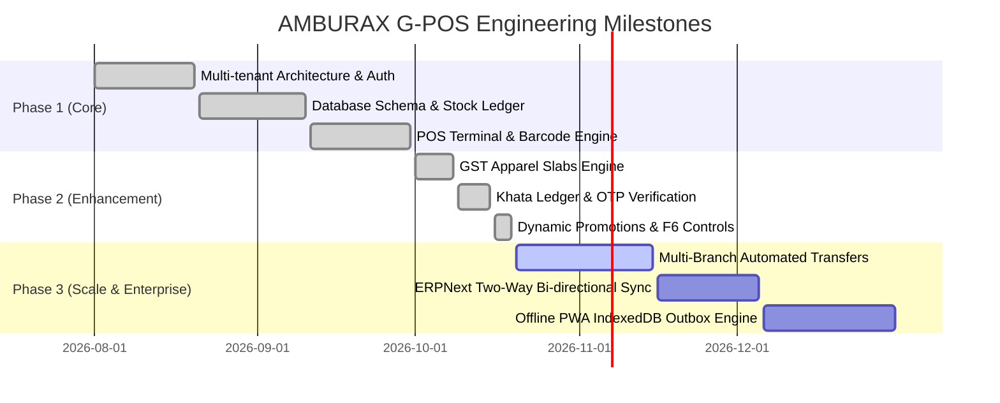

# Project Roadmap and Scope Document

| Document ID | AMB-RDMP-004 | Version | 1.0.0 |
| :--- | :--- | :--- | :--- |
| **System** | AMBURAX G-POS | Status | Active / Phase 2 Completed |
| **Date** | 2026-10-19 | Authors | Product Management & Engineering Leadership |

---

## 1. Development Phases & Milestones

---

## 2. Feature Status Register

| Feature / Capability | Category | Phase | Status | Technical Reference |
| :--- | :--- | :--- | :--- | :--- |
| **Barcode Scanning (1D/2D)** | POS Core | 1 | Complete | `apps/web/src/server/pos/scanClassifier.ts` |
| **F-Key Keyboard Navigation** | POS Core | 1 | Complete | `apps/web/src/app/(app)/pos/PosTerminal.tsx` |
| **Split Tenders (Cash/UPI/Card)** | Checkout | 1 | Complete | `apps/web/src/server/sales/saleService.ts` |
| **Hold & Recall Carts** | Checkout | 1 | Complete | `apps/web/src/server/pos/holdCartService.ts` |
| **Apparel Dual GST Slabs** | Taxation | 2 | Complete | `apps/web/src/server/tax/taxSettings.ts` |
| **Company-Scoped Khata** | Accounting | 2 | Complete | `apps/web/src/server/khata/creditSalePosting.ts` |
| **Continuous Multi-bill Udhar** | Accounting | 2 | Complete | `creditSalePosting.ts` (Overdue bypass) |
| **Customer Mobile SMS OTP** | Auth/KYC | 2 | Complete | `apps/web/src/server/customers/customerService.ts` |
| **F6 In-Modal Offer Controls** | Pricing | 2 | Complete | `ApplyOfferModal.tsx` & `promotionEngine.ts` |
| **Single-Offer Mode & Clear** | Pricing | 2 | Complete | `evaluatePromotions()` |
| **Stock Double-Entry Movement** | Inventory | 1 | Complete | `apps/web/src/server/inventory/stockLedger.ts` |
| **Cash Float Opening / Closing** | Shift SOP | 2 | Complete | `apps/web/src/server/pos/posSessionService.ts` |
| **ERPNext Sync Connector** | ERP Adapter | 3 | In Progress | `apps/web/src/server/erp/erpAdapter.ts` |
| **Native Mobile Cashier App** | Mobility | 3 | Planned | React Native / Expo Architecture |

---

## 3. Risks, Dependencies & Mitigations

1. **Internet Fluctuations at Retail Counters**:
   - *Risk*: POS fails to complete bills when local broadband drops.
   - *Mitigation*: Service worker caching with local indexedDB pending transactions; optimistic queue synchronization upon reconnection.
2. **Promotional Margin Leakage**:
   - *Risk*: Stacking multiple offers wipes out operating margins.
   - *Mitigation*: Strict single-best-offer enforcement enabled by default; cashier override explicitly restricted.
3. **Credit Default in Khata**:
   - *Risk*: Customers accumulate excessive debt across multiple branches.
   - *Mitigation*: Company-scoped centralized credit ceiling; real-time balance calculations with instant SMS alerts on every debit.
