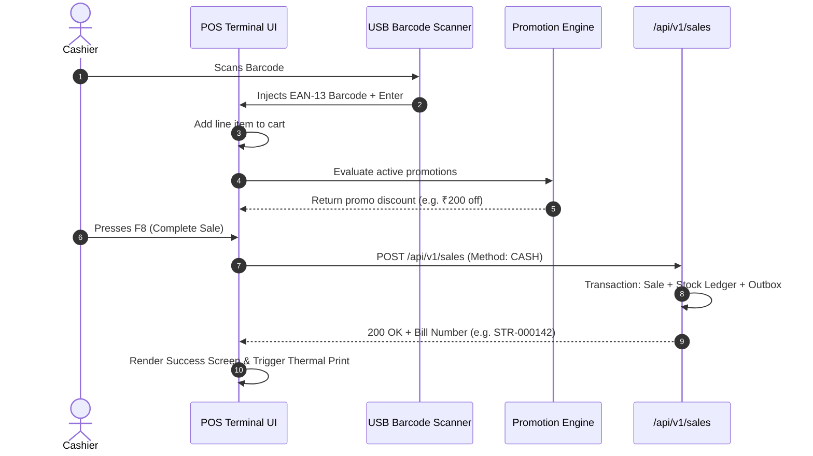
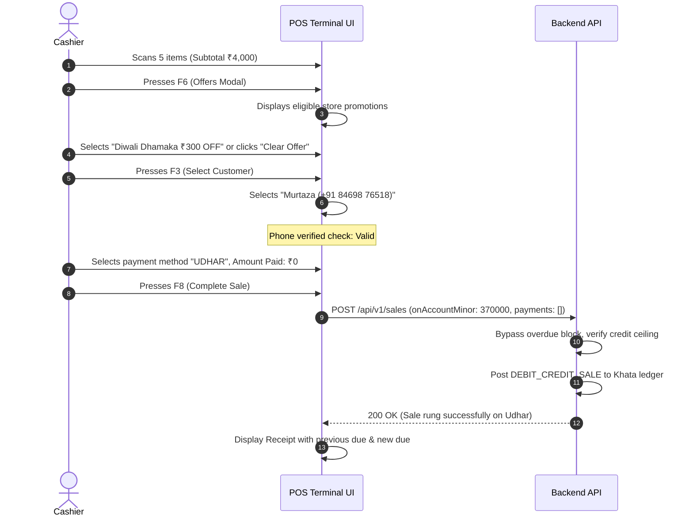

# Screen Inventory and User Flows

| Document ID | AMB-DES-002 | Version | 1.0.0 |
| :--- | :--- | :--- | :--- |
| **System** | AMBURAX G-POS | Status | Approved |
| **Date** | 2026-10-19 | Authors | Product Design Team |

---

## 1. Master Screen Inventory

| Screen Name | Route / Modal | Target Audience | Primary Function |
| :--- | :--- | :--- | :--- |
| **POS Terminal** | `/pos` | Cashier, Floor Staff | Counter billing, scanning, tender selection |
| **Offer Control Modal** | `F6 Modal` | Cashier, Manager | Toggle offers, select active promo, add new offer |
| **Customer Picker** | `F3 Modal` | Cashier | Search customer, view due, OTP verification |
| **Split Tender Modal** | `F7 Modal` | Cashier | Allocate multiple payment methods |
| **Hold / Recall Modal** | `F4 Modal` | Cashier | Park active sale, resume held bill |
| **Shift Management** | `/shifts` | Cashier, Manager | Open drawer float, shift summary, close drawer |
| **Products & Variants** | `/catalog` | Inventory Mgr | Add product, manage barcodes, pricing, tax rates |
| **Khata Accounts** | `/khata` | Accountant, Owner | Customer credit statements, repayments, adjustments |
| **Purchases & Receiving** | `/purchases` | Inventory Mgr | Purchase orders, GRN receiving, supplier dues |
| **Reports & Analytics** | `/reports` | Store Owner | Sales summary, gross margins, GST return exports |

---

## 2. End-to-End User Flows

### Flow 1: Standard Cash / UPI Checkout

### Flow 2: Pure Udhar (Credit) Sale with Offers

