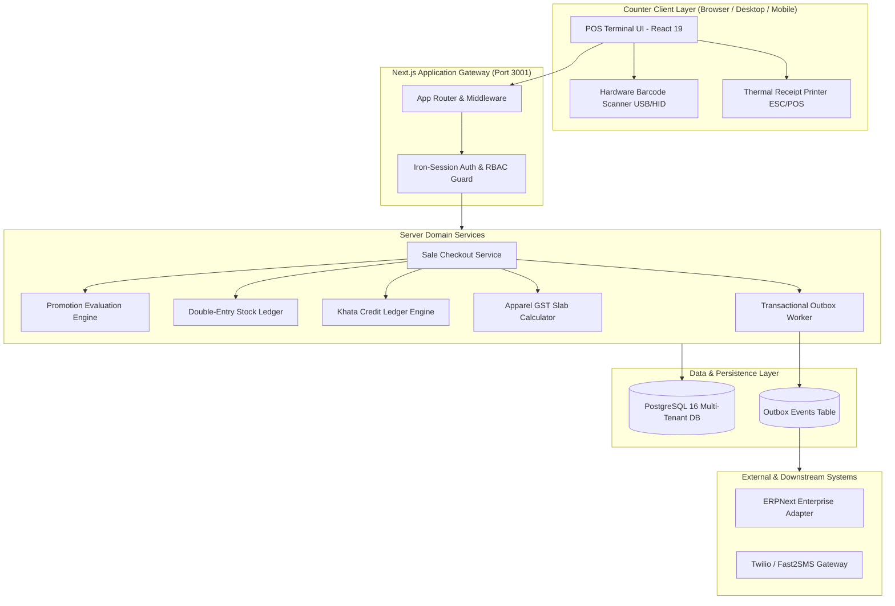

# System Architecture Document

| Document ID | AMB-ARCH-001 | Version | 1.0.0 |
| :--- | :--- | :--- | :--- |
| **System** | AMBURAX G-POS | Status | Approved |
| **Date** | 2026-10-19 | Authors | Principal Software Architect |

---

## 1. High-Level Architectural Blueprint

AMBURAX G-POS follows a modern modular monolith architecture deployed with Next.js 15, React 19, and PostgreSQL 16. It couples client-side speed with server-side transactional authority.

---

## 2. Core Architectural Principles

1. **Zero Financial Authority on the Client**:
   - The browser sends only IDs and quantities (`variantId`, `quantity`, `paymentMethod`).
   - Every price, discount rule, tax slab, and credit ceiling is strictly recomputed inside `saleService.ts` within an ACID database transaction.
2. **ACID Transactional Boundary**:
   - The Sale creation, item lines, tender allocation, stock decrement, customer khata debit, and outbox event enqueue occur in a **single database transaction**.
   - If stock is insufficient or customer credit is exceeded, the entire transaction rolls back cleanly.
3. **Strict Idempotency**:
   - Every mutative request requires an `idempotencyKey` UUID generated by the client.
   - If a network timeout or accidental double-click occurs, the PostgreSQL unique constraint catches the collision and returns the existing sale receipt rather than charging twice.
4. **Company-Scoped Accounting**:
   - Customer credit (Khata) is isolated by legal Company (`companyId`), ensuring liability never crosses separate store entities.
