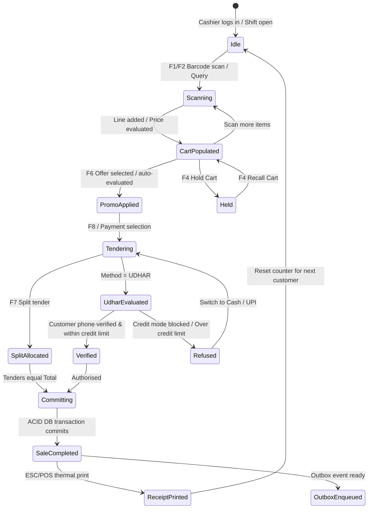
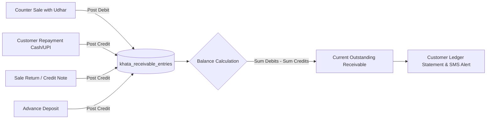

# Data Flow and State Diagrams

| Document ID | AMB-ARCH-003 | Version | 1.0.0 |
| :--- | :--- | :--- | :--- |
| **System** | AMBURAX G-POS | Status | Approved |
| **Date** | 2026-10-19 | Authors | Core Architecture Team |

---

## 1. POS Transaction State Lifecycle

---

## 2. Customer Khata Ledger Flow

