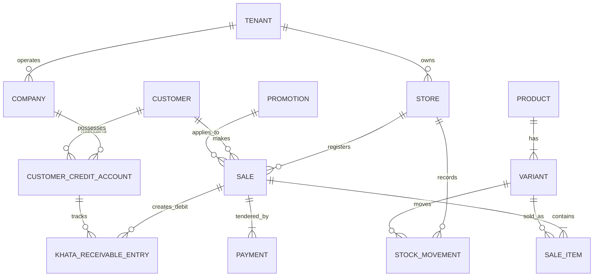

# Database Schema & Entity Relationship Diagram (ERD)

| Document ID | AMB-DB-001 | Version | 1.0.0 |
| :--- | :--- | :--- | :--- |
| **System** | AMBURAX G-POS | Status | Approved |
| **Date** | 2026-10-19 | Authors | Database Engineering Team |

---

## 1. High-Level Entity Relationship Diagram (ERD)

---

## 2. Core Tables and Relationships

### 2.1 `sales` (Authoritative Sales Invoices)
- `id` (UUID, Primary Key)
- `tenantId` (UUID, FK -> tenants)
- `storeId` (UUID, FK -> stores)
- `companyId` (UUID, FK -> companies, Nullable)
- `billNumber` (String, e.g. `STR-000142`, Unique within Store)
- `idempotencyKey` (String, Unique within Tenant)
- `customerId` (UUID, FK -> customers, Nullable)
- `subtotalMinor` (Integer, Paisa)
- `taxMinor` (Integer, Paisa)
- `discountMinor` (Integer, Paisa)
- `totalMinor` (Integer, Paisa)
- `paidMinor` (Integer, Paisa)
- `onAccountMinor` (Integer, Paisa, Udhar portion)
- `paymentMethod` (Enum: `CASH`, `UPI`, `CARD`, `SPLIT`, `UDHAR`)
- `erpSyncStatus` (Enum: `PENDING`, `SYNCED`, `FAILED`, `IGNORED`)
- `completedAt` (Timestamp)

### 2.2 `khata_receivable_entries` (Immutable Credit Ledger)
- `id` (UUID, Primary Key)
- `tenantId` (UUID)
- `companyId` (UUID)
- `customerId` (UUID)
- `creditAccountId` (UUID, FK -> customer_credit_accounts)
- `entryType` (Enum: `DEBIT_CREDIT_SALE`, `CREDIT_REPAYMENT`, `CREDIT_SALE_RETURN`, `CREDIT_ADVANCE_APPLY`, `DEBIT_REVERSAL`, `CREDIT_REVERSAL`)
- `amountMinor` (Integer, Paisa, Non-negative)
- `saleId` (UUID, Nullable, Linked counter sale)
- `idempotencyKey` (String, Unique within Tenant)
- `postedAt` (Timestamp)

### 2.3 `stock_movements` (Double-Entry Inventory Journal)
- `id` (UUID, Primary Key)
- `tenantId` (UUID)
- `storeId` (UUID)
- `variantId` (UUID, FK -> variants)
- `type` (Enum: `SALE`, `PURCHASE_RECEIPT`, `TRANSFER_IN`, `TRANSFER_OUT`, `ADJUSTMENT`, `RETURN`)
- `quantityDelta` (Integer, Negative for sales, positive for receipts)
- `referenceType` (Enum: `SALE`, `PURCHASE_ORDER`, `TRANSFER_ORDER`)
- `referenceId` (UUID)
- `idempotencyKey` (String, Unique within Tenant)
- `createdAt` (Timestamp)

### 2.4 `promotions` (Discount Schemes)
- `id` (UUID, Primary Key)
- `tenantId` (UUID)
- `name` (String)
- `type` (Enum: `PERCENTAGE`, `FLAT`, `BOGO`, `TIERED_SPEND`)
- `criteria` (JSONB, Min spend, required items, eligible categories)
- `discountValueMinor` (Integer, Rupee or Bp)
- `isActive` (Boolean)
- `validFrom` (Timestamp)
- `validTo` (Timestamp)
