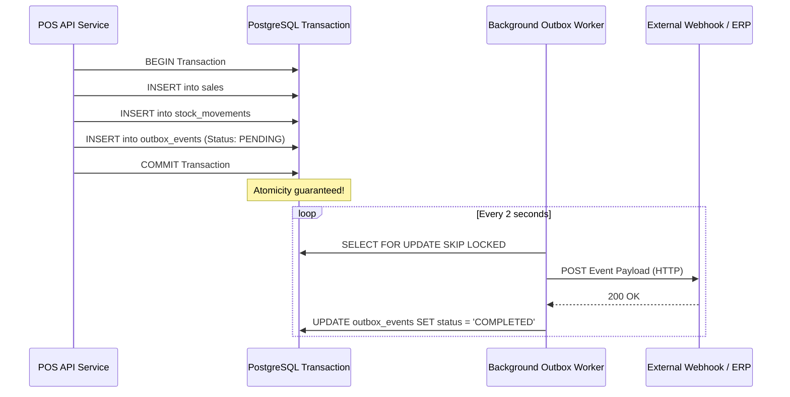

# Webhooks and Outbox Events Reference

| Document ID | AMB-API-002 | Version | 1.0.0 |
| :--- | :--- | :--- | :--- |
| **System** | AMBURAX G-POS | Status | Approved |
| **Date** | 2026-10-19 | Authors | Event-Driven Architecture Team |

---

## 1. The Transactional Outbox Pattern

To ensure zero event loss without requiring distributed 2-Phase Commit (2PC) transactions, AMBURAX G-POS uses the **Transactional Outbox Pattern**:



---

## 2. Event Types and Payloads

### 2.1 `SaleCompleted`
- **Trigger**: Fired immediately upon successful counter checkout.
- **Payload**:
  ```json
  {
    "eventId": "evt_81920",
    "eventType": "SaleCompleted",
    "tenantId": "tnt_001",
    "storeId": "str_101",
    "occurredAt": "2026-10-19T05:30:00.000Z",
    "payload": {
      "saleId": "sale_71829",
      "billNumber": "STR-000142",
      "subtotalMinor": 400000,
      "discountMinor": 30000,
      "taxMinor": 44400,
      "totalMinor": 414400,
      "paidMinor": 100000,
      "onAccountMinor": 314400,
      "lineCount": 4,
      "customerId": "cust_38192"
    }
  }
  ```

### 2.2 `StockAdjusted`
- **Trigger**: Fired on inventory physical stock count reconciliations or damaged write-offs.

### 2.3 `KhataPaymentReceived`
- **Trigger**: Fired when a customer repays an outstanding Udhar balance at the counter or via online payment link.
