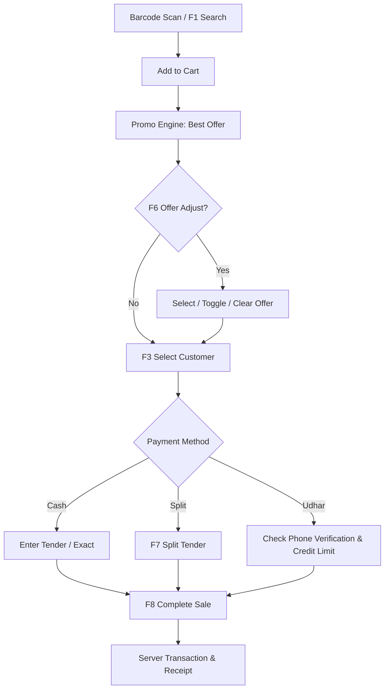

# POS Billing and Checkout Module

| Document ID | AMB-MOD-001 | Version | 1.0.0 |
| :--- | :--- | :--- | :--- |
| **System** | AMBURAX G-POS | Status | Approved |
| **Date** | 2026-10-19 | Authors | POS Product Engineering Team |

---

## 1. Functional Overview

The POS Billing module (`/pos`) is the central hub of store operations. It handles scanning, cart operations, customer identification, discounts, sales attribution, and split tendering.

---

## 2. Key Operational Features

### 2.1 Fast-Scan Catalog Resolution
- Barcode scanner keystrokes are captured without losing cursor position.
- If an exact barcode match is found, the item is immediately added to the cart with default quantity 1.
- If multiple items match a text query, a keyboard-navigable dropdown displays size, color, stock, and price.

### 2.2 Split Tender & Multi-Payment Allocation
- Cashiers can split a bill across Cash, UPI, Card, and Udhar.
- The UI displays dynamic calculations for:
  - `Amount Tendered`
  - `Amount Remaining`
  - `Change Due`
- System blocks completion if remaining amount is non-zero, ensuring exact financial reconciliation.

### 2.3 Cart Hold and Resume (`F4`)
- Up to 10 active carts can be held concurrently.
- Held carts persist across browser refreshes using local storage and server session memory.
