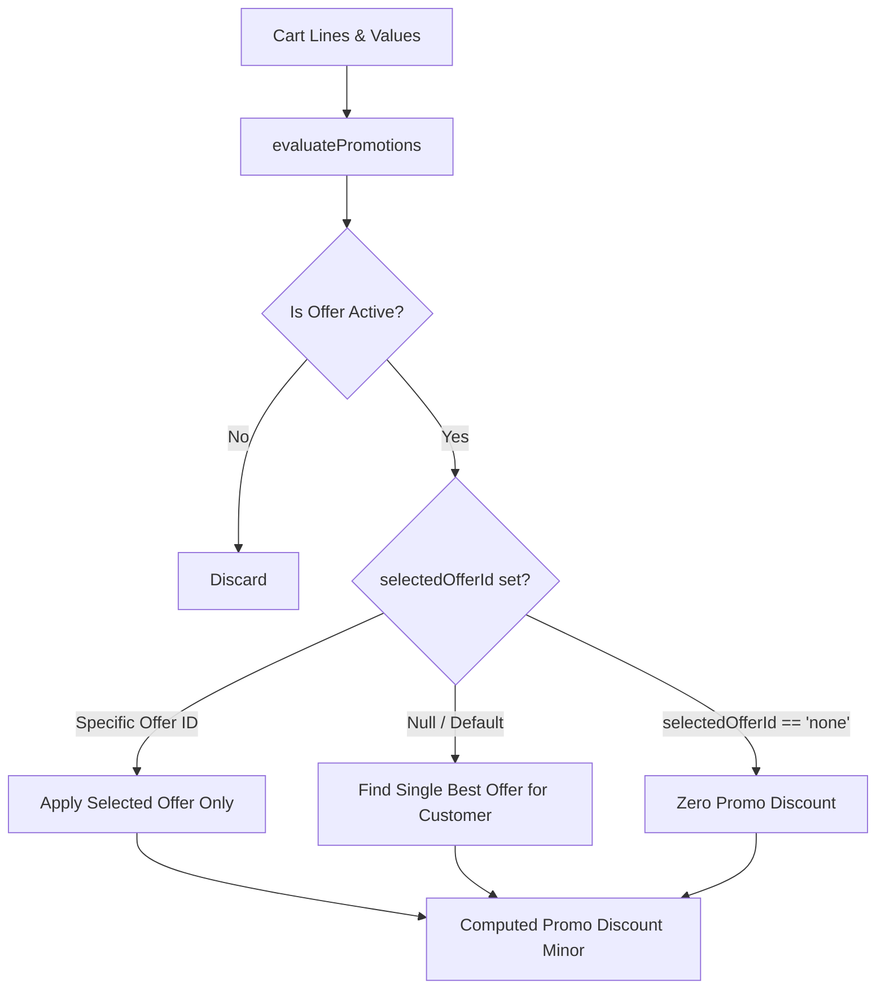

# Promotions & Offers Engine

| Document ID | AMB-MOD-002 | Version | 1.0.0 |
| :--- | :--- | :--- | :--- |
| **System** | AMBURAX G-POS | Status | Approved |
| **Date** | 2026-10-19 | Authors | Pricing & Promotion Engineering Team |

---

## 1. Engine Capabilities & Promotion Types

The AMBURAX G-POS promotion engine (`promotionEngine.ts`) evaluates cart lines dynamically against active store schemes:

1. **Percentage Discounts**: e.g., "10% Off on Men's Shirts".
2. **Flat Rupee Value Off**: e.g., "Flat ₹500 Off on orders above ₹3,000".
3. **BOGO (Buy X Get Y Free)**: e.g., "Buy 2 T-Shirts, Get 1 Free" (cheapest item automatically discounted).
4. **Tiered Spend Schemes**:
   - Spend ₹2,000 $\rightarrow$ Get ₹200 Off.
   - Spend ₹5,000 $\rightarrow$ Get ₹600 Off.
   - Spend ₹10,000 $\rightarrow$ Get ₹1,500 Off.

---

## 2. Single-Offer Mode & Counter Controls

To protect store profitability and support flexible customer relationships:

### 2.1 In-Terminal F6 Management Modal
- **Start / Stop Toggle**: Switch an offer between active and paused states on the fly.
- **Single-Choice Radio Picker**: Select which offer applies to this bill.
- **Clear / Remove Offer Button**: Cashiers can uncheck all offers with one click. Essential for Udhar transactions where discounts are withheld.
- **Add Offer Inline**: Create new store discount rules directly from the terminal without leaving the sales counter.
