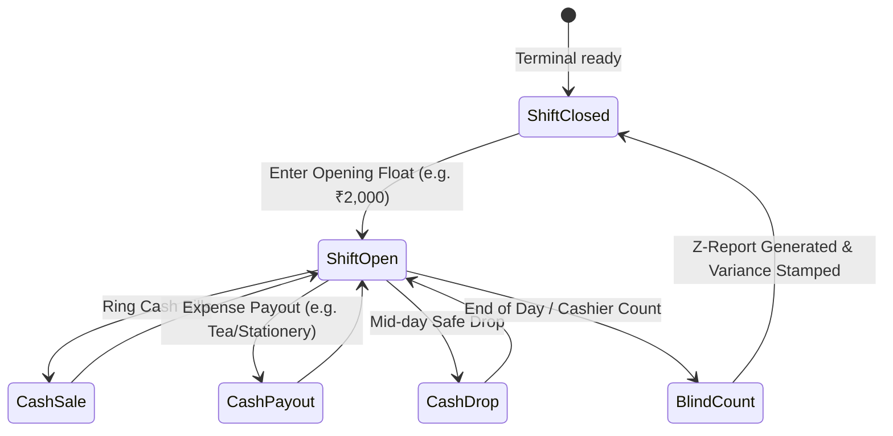

# Shifts, Cash Drawer & Reconciliation Module

| Document ID | AMB-MOD-005 | Version | 1.0.0 |
| :--- | :--- | :--- | :--- |
| **System** | AMBURAX G-POS | Status | Approved |
| **Date** | 2026-10-19 | Authors | Retail Operations Team |

---

## 1. Cash Register Lifecycle (Opening, Movements & Close)

---

## 2. Shift Reconciliation Formula

At the end of a shift, the system generates the **Z-Report**:

$$\text{Expected Cash} = \text{Opening Float} + \text{Cash Sales} - \text{Cash Refunds} - \text{Cash Payouts} - \text{Mid-day Safe Drops}$$

$$\text{Cash Variance} = \text{Physical Count Declared} - \text{Expected Cash}$$

- **Zero Tolerance**: Any variance where $|\text{Variance}| > \text{₹100}$ requires an explicit explanation from the cashier and manager sign-off.
- **Drawer Kick Integration**: Terminal sends raw ESC/POS pulse codes (`27, 112, 0, 25, 250`) to trigger the RJ11 cash drawer solenoid upon bill completion or manual `F11` trigger.
