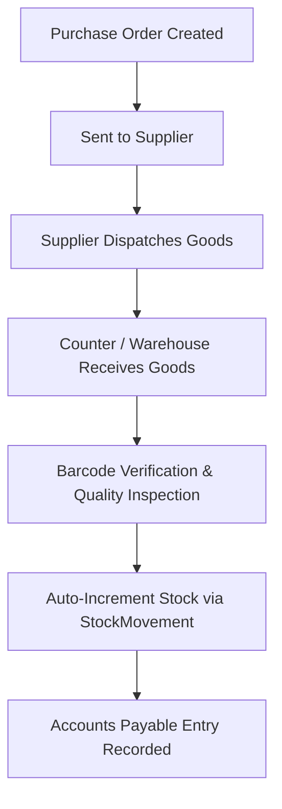

# Purchases, Suppliers & Goods Receiving (GRN)

| Document ID | AMB-MOD-006 | Version | 1.0.0 |
| :--- | :--- | :--- | :--- |
| **System** | AMBURAX G-POS | Status | Approved |
| **Date** | 2026-10-19 | Authors | Supply Chain & Purchasing Team |

---

## 1. Purchasing Lifecycle & Inbound Stock Flow

---

## 2. Goods Receiving Note (GRN) Verification Rules

1. **Barcode Matching**: Incoming vendor items are scanned with the USB scanner. If a barcode does not exist in the tenant catalog, the system prompts for immediate variant creation or barcode mapping.
2. **Purchase Price vs. Landed Cost**:
   - Captures Vendor Base Price, Freight Charges, and Input GST (CGST/SGST/IGST).
   - Computes landed unit cost to update inventory valuation figures.
3. **Automated Stock Increment**:
   - Committing a GRN creates an immutable `PURCHASE_RECEIPT` entry in `stock_movements`.
   - The received inventory immediately becomes sellable at the POS counters.
