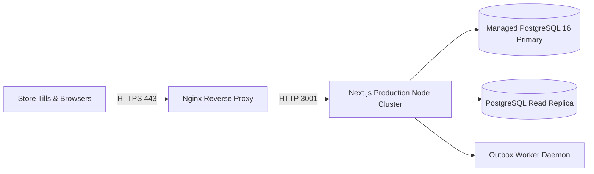

# Production Deployment Guide

| Document ID | AMB-OPS-002 | Version | 1.0.0 |
| :--- | :--- | :--- | :--- |
| **System** | AMBURAX G-POS | Status | Approved |
| **Date** | 2026-10-19 | Authors | Site Reliability Engineering (SRE) Team |

---

## 1. Production Architecture Overview

In production, AMBURAX G-POS runs as a containerized Node.js service behind an Nginx reverse proxy with SSL termination:



---

## 2. Production Deployment Runbook

### Step 1: Build Production Artifacts
```bash
npm run build
```

### Step 2: Apply Production Migrations
```bash
npx prisma migrate deploy
```

### Step 3: Run Process Manager (PM2 / Systemd)
```bash
# Start Web Server with 4 cluster instances
pm2 start npm --name "gpos-web" -i 4 -- run start -- -p 3001

# Start Transactional Outbox Background Worker
pm2 start npm --name "gpos-outbox" -- run outbox:work

# Save PM2 process list across reboots
pm2 save
```

### Step 4: Health Check & Verification
Verify the application health endpoint:
```bash
curl -I http://localhost:3001/api/v1/health
# Expected: HTTP/1.1 200 OK
```
