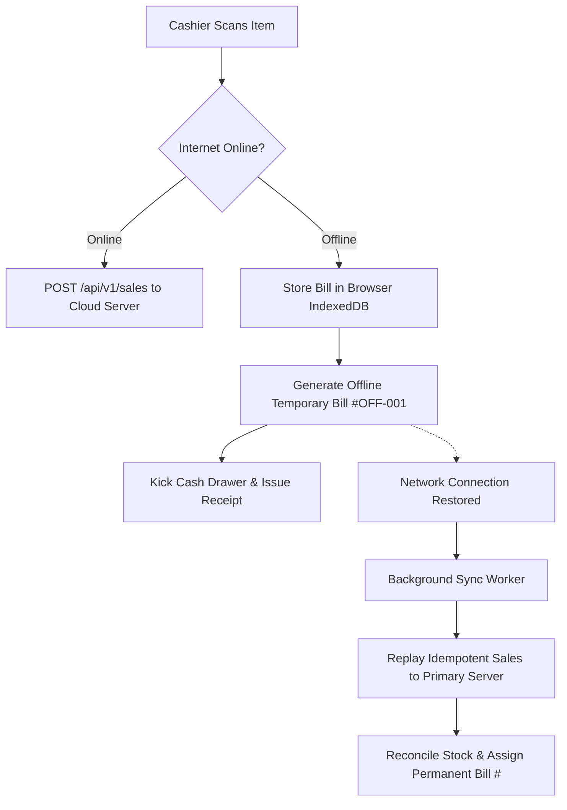

# Offline POS Specification & Conflict Resolution

| Document ID | AMB-POS-002 | Version | 1.0.0 |
| :--- | :--- | :--- | :--- |
| **System** | AMBURAX G-POS | Status | Approved |
| **Date** | 2026-10-19 | Authors | Distributed Systems Architecture Team |

---

## 1. Offline Counter Resilience Model

During retail counter operations, intermittent broadband cuts must never stop cashiers from ringing cash bills:

---

## 2. Conflict Resolution & Invariant Protection

1. **Client-Side Idempotency Keys**:
   - Every offline bill generates a UUID `idempotencyKey` at the moment of completion.
   - If a sync request is retried multiple times when the internet flickers, the server processes it once.
2. **Stock Shortage Handling**:
   - If two offline tills sell the last unit of a shirt concurrently, the server accepts both transactions upon sync to preserve counter customer trust, and flags an immediate `NEGATIVE_STOCK_ALERT` on the manager dashboard for warehouse replenishment.
3. **Credit (Udhar) Restrictions in Offline Mode**:
   - Pure Cash sales are permitted offline.
   - Udhar sales require live server connectivity to verify customer credit ceilings unless the customer holds an offline pre-approved token.
