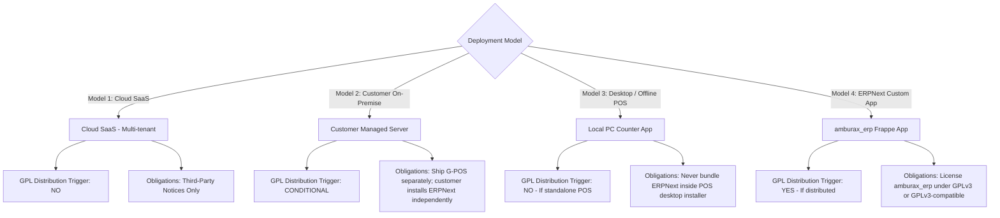

# AMBURAX G-POS — Deployment & Distribution Matrix

| Document ID | AMB-POL-DIST-001 | Version | 1.0.0 |
| :--- | :--- | :--- | :--- |
| **System** | AMBURAX G-POS | Status | Approved |
| **Date** | 2026-10-19 | Authors | Legal Counsel & Infrastructure Architecture Team |

---

## 1. Overview & Distribution Trigger Analysis

Under copyright law and the GNU General Public License v3.0 (GPLv3):
- **Operating a Service (SaaS)**: Running software on your own cloud servers and providing access over HTTP does **NOT** constitute "conveying" or "distributing" software under GPLv3 Section 9.
- **Conveying (Distribution)**: Providing software binaries, installation packages, Docker images, or source code to third parties triggers distribution obligations (such as making corresponding source code available under GPLv3 Section 6).

---

## 2. Four Deployment Models & Legal Obligations

---

## 3. Specific Model Procedures & Rules

### Model 1: Cloud SaaS Deployment (Recommended Primary Model)
- **Deployment Topology**: AMBURAX operates Next.js (port 3001) and PostgreSQL 16 on managed cloud infrastructure (AWS / GCP / Hetzner). ERPNext runs on a separate cluster or managed bench.
- **Copyleft Impact**: **ZERO**. GPLv3 obligations do not attach to proprietary SaaS applications accessed via web browsers.
- **Mandatory Requirements**: Maintain a public `/about/licenses` page displaying third-party license notices.

### Model 2: Customer-Managed / On-Premise Deployment
- **Deployment Topology**: Customer runs AMBURAX G-POS on their own physical store server.
- **Golden Rule**: **NEVER ship a monolithic container or installer that bundles proprietary AMBURAX G-POS and ERPNext together.**
- **Safe Procedure**:
  1. Distribute AMBURAX G-POS as a standalone proprietary container or application.
  2. ERPNext is treated as an external prerequisite service. Provide installation scripts that download ERPNext directly from upstream official repositories (`frappe/erpnext`).

### Model 3: Desktop / Offline POS Terminal Installation
- **Scope**: Electron or PWA cashier counter client installed on Windows 11 / Linux store PCs.
- **Golden Rule**: The desktop package contains only the frontend counter terminal (`apps/web`). It connects via local LAN or cloud APIs. Zero GPL code is bundled into the desktop `.exe` or package.

### Model 4: Distribution of Custom Frappe Apps (`amburax_erp`)
- **Scope**: Any custom DocTypes, Python hooks, or server scripts created on the Frappe side.
- **Mandatory Requirement**: If the `amburax_erp` app is distributed to customers, it must be released under **GPLv3** (or a GPLv3-compatible license) in a separate public or private repository. It must **never** be merged into the proprietary `G-POS` repository.
